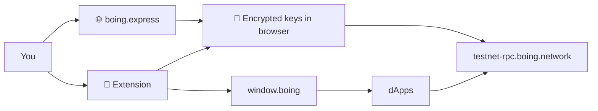

# 👛 Boing Express (Boing Wallet)

Non-custodial wallet for **Boing Network**. Keys are generated and stored **only in your browser**. Live at **[boing.express](https://boing.express)**.

**Boundary:** Boing Express is a **Boing-native** wallet (`window.boing`, 32-byte AccountIds, Ed25519). It is **not** MetaMask and does **not** run an EVM (no ethers/revm/geth execution). EVM wallets belong with **boing.finance** on EVM chains.

> 👋 **Everyday users:** create or import a wallet, copy your 64-character address, get testnet BOING from [the faucet](https://boing.network/faucet), send, stake. The Chrome/Firefox extension adds “Connect wallet” for dApps.  
> 🛠️ **Developers:** inject `window.boing`. Methods: `boing_requestAccounts`, `boing_sendTransaction`, DEX list RPCs. See [docs/WALLET_CONNECTION_AND_API.md](docs/WALLET_CONNECTION_AND_API.md).  
> 🛰️ **Operators:** `VITE_BOING_TESTNET_RPC` defaults to `https://testnet-rpc.boing.network`. Mainnet stays **off** until `VITE_BOING_MAINNET_RPC` is a distinct URL.



## ✨ Features

- **Boing Network:** Ed25519 addresses (32-byte AccountId, 64-char hex), send/receive BOING, testnet faucet, staking (Bond/Unbond/ClaimUnbond)
- **Assets / NFTs:** BOING balance plus reference-NFT watchlist, recent-block discovery, and `transfer_nft` (see [docs/DEVELOPMENT.md](docs/DEVELOPMENT.md)). Official NFT↔fungible **companion peers** are read from the on-chain registry and shown under matching collections — [BOING-LINKED-NFT-TOKEN.md](https://github.com/Boing-Network/boing.network/blob/main/docs/BOING-LINKED-NFT-TOKEN.md). Optional on-chain **builder attested** signal (separate registry; read-only when surfaced) — [BOING-BUILDER-ATTESTATION.md](https://github.com/Boing-Network/boing.network/blob/main/docs/BOING-BUILDER-ATTESTATION.md)
- **Signing:** BLAKE3 signable hash + Ed25519; bincode layout matches `boing-primitives`
- **Security:** Client-only key generation, password-encrypted storage (AES-GCM), keys never sent to any server
- **Recovery phrase:** new wallets get a 24-word BIP-39 phrase (import accepts 12 or 24); SLIP-0010 Ed25519, no new dependencies. Raw-key accounts keep working unchanged. Shown again only after your password. [docs/RECOVERY_PHRASE_DESIGN.md](docs/RECOVERY_PHRASE_DESIGN.md)
- **Extension:** Injects `window.boing` for dApp connect; Connected sites management in the popup

## 🧰 Tech stack

- **React 18** + **TypeScript** + **Vite** (static build → `dist/`)
- **@noble/ed25519** and **@noble/hashes** (BLAKE3)
- **Cloudflare Pages**; optional **RPC gateway Worker** ([docs/RPC_GATEWAY.md](docs/RPC_GATEWAY.md))

## 🚀 Quick start

```bash
pnpm install
pnpm dev
```

Open http://localhost:5173. Production build: `pnpm build` → `dist/`.

## ⚙️ Environment

| Variable | Description |
|----------|-------------|
| `VITE_BOING_TESTNET_RPC` | Testnet JSON-RPC (default `https://testnet-rpc.boing.network`) |
| `VITE_BOING_MAINNET_RPC` | Optional mainnet JSON-RPC. Leave unset until official mainnet is published |

Set these in Cloudflare Pages **Build → Environment variables** (baked in at build time).

## ☁️ Cloudflare (boing.express)

- Pages project, build `pnpm build`, output `dist`, domain **boing.express**
- GitHub Actions deploys on `main`. Secrets: `CLOUDFLARE_ACCOUNT_ID`, `CLOUDFLARE_API_TOKEN`
- Optional RPC gateway: `pnpm run gateway:deploy` — see [docs/RPC_GATEWAY.md](docs/RPC_GATEWAY.md)

```bash
pnpm build
npx wrangler pages deploy dist --project-name=boing-wallet
```

## 🧩 Browser extension

```bash
pnpm run build:extension
```

Chrome: `chrome://extensions` → Developer mode → Load unpacked → **`extension/`** folder.  
Firefox: `about:debugging` → Load Temporary Add-on → `extension/manifest.json`.

Recommended pre-review copy: `pnpm run build:extension:unpacked` → load **`extension-unpacked/`**. Store zip: `pnpm run zip:extension`. Listing checklist: [docs/EXTENSION_STORE.md](docs/EXTENSION_STORE.md).

## 📡 Boing Network details

- **Address:** 32-byte AccountId = Ed25519 public key, 64 hex chars (optional `0x`)
- **Submit:** `hex(bincode(SignedTransaction))` via `boing_submitTransaction`
- **Explorer:** `https://boing.observer/account/<address>`
- **Alignment:** [THREE-CODEBASE-ALIGNMENT.md](https://github.com/Boing-Network/boing.network/blob/main/docs/THREE-CODEBASE-ALIGNMENT.md)

## 📚 Docs in this repo

| Doc | For |
|-----|-----|
| [docs/WALLET_CONNECTION_AND_API.md](docs/WALLET_CONNECTION_AND_API.md) | `window.boing` provider API |
| [docs/DEVELOPMENT.md](docs/DEVELOPMENT.md) | CI, tests, Chrome Web Store checklist |
| [docs/BOING-EXPRESS-WALLET.md](docs/BOING-EXPRESS-WALLET.md) | Product + integration spec |
| [docs/RPC_GATEWAY.md](docs/RPC_GATEWAY.md) | Optional HTTPS JSON-RPC Worker |
| [docs/CODEBASE-ALIGNMENT.md](docs/CODEBASE-ALIGNMENT.md) | Local summary of cross-repo URLs |
| [docs/NETWORK_SETUP.md](docs/NETWORK_SETUP.md) | Network config, runtime node check, signing chain id |
| [docs/SECURITY.md](docs/SECURITY.md) | Security model, auto-lock, CSP |
| [docs/TESTING.md](docs/TESTING.md) | Unit, web and extension e2e tests |
| [docs/HANDOFF.md](docs/HANDOFF.md) | Portal / protocol handoff |
| [docs/DESIGN_SYSTEM.md](docs/DESIGN_SYSTEM.md) | Aqua Personal tokens |
| Upstream [BOING-LINKED-NFT-TOKEN.md](https://github.com/Boing-Network/boing.network/blob/main/docs/BOING-LINKED-NFT-TOKEN.md) | On-chain NFT↔token link registry (SDK / dApp discovery) |
| Upstream [BOING-BUILDER-ATTESTATION.md](https://github.com/Boing-Network/boing.network/blob/main/docs/BOING-BUILDER-ATTESTATION.md) | On-chain builder attestation registry (builder signal; companions remain project authority) |

## Everyday use and safety

- **Backup check:** new wallets default to a 24-word recovery phrase (BIP-39, SLIP-0010 Ed25519 path `m/44'/1112492366'/0'/0'/0'`); you must confirm three words before continuing. Choosing "Private key" instead keeps the classic check (retype the last 6 characters). Import accepts a 12 or 24 word phrase or a raw key. See [docs/RECOVERY_PHRASE_DESIGN.md](docs/RECOVERY_PHRASE_DESIGN.md).
- **Plain-language errors:** RPC and node errors are translated (for example "insufficient balance", "nonce too low", "wrong network").
- **Wrong-network guard:** a banner appears and broadcasting is refused when the node is on a different chain than the one you selected.
- **Auto-lock:** the extension locks after 15 idle minutes by default (Settings).
- **dApp prompts:** explicit "Connect to this site?" and signing approvals, with warnings for suspicious origins.

More: [docs/SECURITY.md](docs/SECURITY.md), [docs/NETWORK_SETUP.md](docs/NETWORK_SETUP.md), [docs/TESTING.md](docs/TESTING.md).

## Scripts

| Command | Purpose |
|---------|---------|
| `pnpm dev` | Vite dev server on http://localhost:5173 |
| `pnpm build` | Type check and build `dist/` |
| `pnpm run build:extension` | Build the MV3 extension into `extension/` |
| `pnpm test` | Unit tests (Vitest) |
| `pnpm test:e2e:web` | Web end-to-end tests (Playwright) |
| `EXTENSION_E2E=1 EXTENSION_E2E_FULL=1 pnpm test:e2e` | Extension end-to-end tests (headed Chromium) |

Requires Node 20+ and pnpm 9 (`corepack enable`).
## License

MIT
