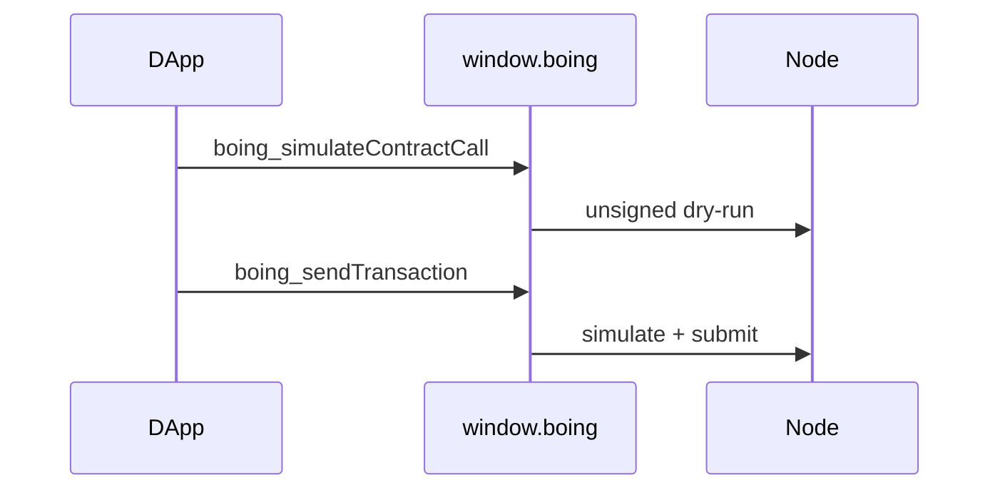

# Boing Express — injected wallet & RPC forwarding

> 👋 **Everyday users:** this is the dApp “Connect” API. You just click Connect.  
> 🛠️ **Developers:** `window.boing.request`. Unsigned simulation vs signed submit paths are below.  
> 🛰️ **Operators:** n/a — wallet client behavior.

> **Which doc is which?** This file, in the boing.express repo, is the **provider / RPC-forwarding reference**: what `window.boing` does and which node methods it forwards. The **canonical product spec** with the same file name (bootstrap, integration, Chrome Web Store) is [`docs/BOING-EXPRESS-WALLET.md` in boing.network](https://github.com/Boing-Network/boing.network/blob/main/docs/BOING-EXPRESS-WALLET.md). If they disagree on product behavior, the canonical spec wins; for exact provider behavior, check [WALLET_CONNECTION_AND_API.md](WALLET_CONNECTION_AND_API.md) and the code.

This document is the **handoff target** referenced from **boing.network** (RPC specs, SDK). It describes what **`window.boing`** does in **Boing Express** and how dApps should call **unsigned simulation** vs **signed** paths.

---

## Provider surface (`window.boing.request`)

| Method | Forwards to | Notes |
|--------|-------------|--------|
| `boing_requestAccounts` | — | Connects origin; requires unlock. |
| `boing_accounts` | — | No RPC. |
| `boing_signMessage` | — | Local signing after approval. |
| `boing_chainId` / `boing_switchChain` | — | Network selection in extension storage. |
| `boing_signTransaction` | — | Local sign → hex `SignedTransaction`. |
| `boing_sendTransaction` | `boing_simulateTransaction` (optional) → `boing_submitTransaction` | Signs first; uses wallet-selected RPC URL. Returns **`{ tx_hash, tx_id }`** (`tx_id` = `Transaction::id()` for receipt polling; mempool `tx_hash` is often `"ok"`). Reference NFT **`mint_batch` (`0x06`)** approval preview: **“Mint N NFTs to {to}”**. After a successful send, minted token-id words are added to the recipient’s NFT watchlist (XOR owner probes + observer item links). |
| `boing_simulateTransaction` | **`boing_simulateTransaction`** | Params: `[hexSignedTx]`. **Connected origin** required. No signing. |
| **`boing_simulateContractCall`** | **`boing_simulateContractCall`** | Params: `[contractHex, calldataHex, senderHex?, atBlock?]`. **Connected origin** required. **Unsigned** dry-run of a `contract_call` (see [RPC-API-SPEC.md — `boing_simulateContractCall`](https://github.com/Boing-Network/boing.network/blob/main/docs/RPC-API-SPEC.md)). |
| **`boing_listDexPools`** | **`boing_listDexPools`** | Params: `[requestObject]` — same single-object argument as **`BoingClient.listDexPoolsPage`** (**@boing-network/boing-sdk** ≥ 0.5.38). **Connected origin** required. Forwards unchanged to the wallet’s selected RPC. |
| **`boing_listDexTokens`** | **`boing_listDexTokens`** | Params: `[requestObject]` — aligns with **`listDexTokensPage`**. **Connected origin** required. |
| **`boing_getDexToken`** | **`boing_getDexToken`** | Params: `[{ id, … }]` — aligns with **`getDexToken`**. **Connected origin** required. |

### DEX discovery reads (`boing_listDexPools` / `boing_listDexTokens` / `boing_getDexToken`)

- **Spec:** [RPC-API-SPEC.md — DEX discovery](https://github.com/Boing-Network/boing.network/blob/main/docs/RPC-API-SPEC.md) and [HANDOFF_Boing_Network_Global_Token_Discovery.md](https://github.com/Boing-Network/boing.network/blob/main/docs/HANDOFF_Boing_Network_Global_Token_Discovery.md) on **boing.network**.
- **Contract:** Request body fields include **`factory`**, **`cursor`**, **`limit`**, **`light`** (or **`enrich`**), **`includeDiagnostics`**, and token-list filters (**`minReserveProduct`**, **`minLiquidityWei`**) as documented upstream. Omitted or non-object first param is sent as **`{}`** (same default as the SDK page helpers).
- **HTTP gateway (optional, same contract):** This repo also includes a **Cloudflare Worker** that proxies allowlisted JSON-RPC over **`POST …/v1/rpc`** and serves **`GET /openapi.json`**. Deploy and configure it separately from the wallet — see **[RPC_GATEWAY.md](RPC_GATEWAY.md)**. BFFs should still document **`boing_health.rpc_surface`** / HTTP rate limits and use **cache keys** that include **`factory`**, pagination, **`light`**, and filter fields. Prefer **cursor pagination** with modest **`limit`** instead of repeated **`limit=500`** loops. **API keys** on the gateway must not be confused with token safety — discovery is **existence / directory** data only.

### `boing_simulateContractCall` (Boing Express behavior)

- **Spec (boing.network):** dry-run `contract_call` without a signed transaction. Align with **`BoingClient.simulateContractCall`** in **boing-sdk**.
- **Security:** Same bar as `boing_simulateTransaction`: the page must be **connected** (`boing_requestAccounts`). No approval popup (read-only RPC).
- **Sender default:** If the dApp passes only `[contractHex, calldataHex]` and the wallet has an active account address in storage, Boing Express **appends that account** as the **third** JSON-RPC parameter so simulations match the connected user. To force a different sender, pass **`senderHex`** explicitly. To pass **`atBlock`**, use four arguments; **`at_block`** must be a non-negative integer (number or decimal string).
- **Alternatives:** dApps may call the same JSON-RPC **directly over HTTPS** to a public RPC URL if **CORS** and deployment policy allow. Otherwise use the provider so the call uses the **wallet’s selected network** (testnet/mainnet) and the same URL as submit/simulate.

### `boing_simulateTransaction` vs `boing_simulateContractCall`

| | `boing_simulateTransaction` | `boing_simulateContractCall` |
|--|-----------------------------|------------------------------|
| Input | Hex-encoded **signed** `SignedTransaction` | **Contract** id + **calldata** (+ optional sender / block) |
| Use case | Preflight a tx you already built and signed | Quote / dry-run **without** building or signing a full tx |

### Linked NFT↔token pairs (dApp / SDK discovery)

Official collection↔fungible links are **enforced on-chain** (not display-only metadata). Protocol + SDK: [BOING-LINKED-NFT-TOKEN.md](https://github.com/Boing-Network/boing.network/blob/main/docs/BOING-LINKED-NFT-TOKEN.md) and **boing-sdk** `linkedNftTokenRegistry.ts` (`buildLinkedNftTokenRegisterFlowTxs`, `encodeLinkedNftToken*`, …).

| Field | Public testnet |
|-------|----------------|
| **Registry AccountId** | `0xf704485ad29f56bb6516ac822fcf9ca8fcb6c4266e22c9ed7f9c6908668655dd` (v2; v1 `0xebf9f0190f415852f90d0e60343126201248ab96273fdbf8acc5fe5fa03c3dd8` superseded) |
| **CREATE2 salt** | `BOING_NFT_TOKEN_LINK_REG_V2` (block 1174) |
| **Selectors** | `0xE0`–`0xE8` (claim / register / unlink / links_count / get_link_at / get_asset_claimer / transfer_asset_claimer / claim_self / get_asset_deployer) |
| **Model** | Dual **asset claimer**; many-to-many; mutable. An asset's claimer is its creator: new assets call `claim_self` from their deploy init code, and `claim_asset` works only for an asset's recorded deployer |

**Boing Express** surfaces reference NFT holdings and, on Assets refresh, **reads** active companion peers from the registry (`links_count` / `get_link_at` via **`boing_simulateContractCall`**, skipping tombstones) and lists them under matching collections with an optional observer account link. It can also sign/submit `contract_call` txs that claim/register/unlink via the provider for dApps. Treat `boing.linked_nft_token.v1` metadata as an optional cache only — the on-chain registry is authority.

### Builder attestation (optional signal; read-only when surfaced)

On-chain **builder attested** records are a **builder signal** for a (collection, token) pair — separate registry and claimer from companions. Companions remain project structure authority. Protocol + SDK: [BOING-BUILDER-ATTESTATION.md](https://github.com/Boing-Network/boing.network/blob/main/docs/BOING-BUILDER-ATTESTATION.md) and **boing-sdk** `builderAttestationRegistry.ts`.

| Field | Public testnet |
|-------|----------------|
| **Registry AccountId** | `0x734077a9f926077d39e84ec278b77b7b600c840f7101809646d8797a6a9e1816` |
| **CREATE2 salt** | `BOING_BUILDER_ATTEST_REG_V1` |
| **Selectors** | `0xE0`–`0xE6` (claim / attest / revoke / attestations_count / get_attestation_at / get_asset_claimer / transfer_asset_claimer) |
| **Model** | Dual **asset claimer** (independent of companions); append + tombstone revoke |

**Boing Express** may later show a compact **Builder attested** line under a matching collection/project (read via `attestations_count` / `get_attestation_at`, skip tombstones). Optional env: `VITE_BOING_BUILDER_ATTESTATION_REGISTRY`. Write/attest flows stay in dApps (boing.finance). Soft wallet-signed JSON proofs are **not** network authority.

---

## Related docs in this repo

- **[WALLET_CONNECTION_AND_API.md](WALLET_CONNECTION_AND_API.md)** — full provider API table and transaction JSON shapes.
- **[HANDOFF.md](HANDOFF.md)** — short integration checklist for portals and dependents.

---

## Change coordination

When **boing.network** adds or changes JSON-RPC methods that dApps expect through **Boing Express**, update:

1. `extension/background.ts` — `BOING_METHODS` + `handleProviderRequest` branch (or document “use HTTP RPC only”).
2. `src/boing/rpc.ts` — thin `rpcCall` wrappers when shared with the web app.
3. This file and **WALLET_CONNECTION_AND_API.md**.

DEX discovery (**`boing_listDexPools`**, **`boing_listDexTokens`**, **`boing_getDexToken`**) follows the same update pattern.
